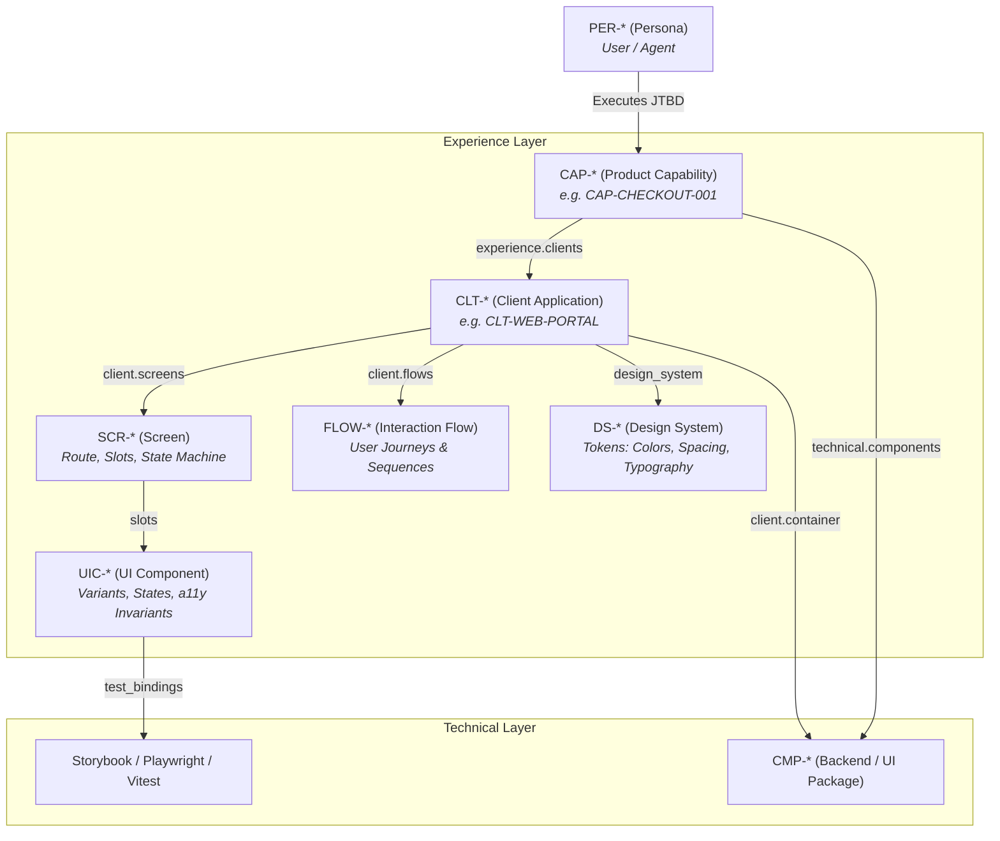

# Multi-Design Systems, Client Applications & UI Contracts

Frontend architecture frequently suffers from a severe disconnect: design tokens in Figma, UI components in React/Vue/Svelte, and product requirements in Jira drift apart over time. 

Eidos resolves this by establishing **Design as a First-Class Living Specification**, codifying **Multi-Design Systems (`DS-*`)**, **Client Applications (`CLT-*`)**, **W3C Design Tokens**, **UI Component Manifests (`UIC-*`)**, **Screen State Machines (`SCR-*`)**, and **Interaction Flows (`FLOW-*`)** directly inside the repository under `eidos/design/`.

---

## 1. The Product-Experience-Technical Trinity

Eidos connects user needs, visual interface, and backend code in an unbroken chain:



Every user-facing capability in [`capability.schema.yaml`](schema-glossary.md#productcapability) declares an `experience:` block linking directly to clients, client-owned screens, interaction flows, and design systems.

---

## 2. Directory Structure (`eidos/design/`)

Eidos employs a scalable multi-client and multi-design-system hierarchy:

```text
eidos/design/
├── systems/                          <- Multi-Design System catalog
│   ├── core/                         <- Base Design System
│   │   ├── system.adoc               <- type: design/system (id: DS-CORE)
│   │   ├── tokens.json               <- W3C tokens (base colors, spacing, typography)
│   │   └── components/               <- Canonical UI Component Manifests
│   │       ├── button.adoc           <- id: UIC-CORE-BUTTON
│   │       └── modal.adoc            <- id: UIC-CORE-MODAL
│   │
│   └── acme/                         <- White-Label / Client Theme
│       ├── system.adoc               <- extends: "DS-CORE", override_mode: "token_and_component"
│       └── tokens.json               <- Brand token overrides
│
├── clients/                          <- Client Applications (CLT-*)
│   └── web-portal/                   <- Web Client target
│       ├── client.adoc               <- type: design/client (id: CLT-WEB-PORTAL)
│       ├── screens/                  <- Client-owned Screens (SCR-*)
│       │   ├── portal-home.adoc      <- route: "/"
│       │   └── portal-catalog.adoc   <- route: "/catalog"
│       └── flows/                    <- Client-internal user journeys (FLOW-*)
│           └── spec-exploration.adoc <- flow_type: client_internal
│
└── flows/                            <- Omnichannel / Cross-Client Journeys
    └── cli-serve-and-browse.adoc     <- flow_type: cross_client (CLI -> Portal)
```

### Base System vs. Brand Extension

A base design system defines the complete foundational tokens and components. A client theme extends the base system and overrides only what is necessary:

```asciidoc
---
type: design/system
schema: schemas/v1/design/system.schema.yaml
id: DS-ACME
title: "Acme Enterprise Theme"
status: active
extends: "DS-CORE"
override_mode: "token_and_component"
tokens:
  spec_format: "w3c_design_tokens"
  manifest: "tokens.json"
---
= Design System: Acme Enterprise Theme

== Overview
Brand token overrides and specialized navigation components for Acme Corp enterprise deployment.
```

---

## 3. W3C DTCG Design Tokens (`tokens.json`)

All design tokens strictly adhere to the official **W3C Design Tokens Community Group (DTCG)** specification (`$value`, `$type`, `$description`). This ensures seamless export to Style Dictionary, Tailwind CSS, CSS variables, and Figma Token Studio.

### Base Tokens (`eidos/design/systems/core/tokens.json`):

```json
{
  "color": {
    "brand": {
      "primary": {
        "$value": "#0052cc",
        "$type": "color",
        "$description": "Primary brand action color"
      },
      "surface": {
        "$value": "#ffffff",
        "$type": "color"
      }
    }
  },
  "spacing": {
    "md": {
      "$value": "16px",
      "$type": "dimension"
    }
  },
  "border": {
    "radius": {
      "button": {
        "$value": "8px",
        "$type": "dimension"
      }
    }
  }
}
```

### Brand Token Override (`eidos/design/systems/acme/tokens.json`):

```json
{
  "color": {
    "brand": {
      "primary": {
        "$value": "#e63946",
        "$type": "color",
        "$description": "Acme corporate red override"
      }
    }
  }
}
```

---

## 4. UI Component Manifests (`UIC-*`)

UI Component manifests (`type: design/ui-component`) define the contract for a reusable visual component, including supported variants, interactive states, accessibility invariants, and automated test bindings.

### Component Manifest Example (`eidos/design/systems/core/components/button.adoc`):

```asciidoc
---
type: design/ui-component
schema: schemas/v1/design/ui-component.schema.yaml
id: UIC-CORE-BUTTON
title: "Action Button"
design_system: "DS-CORE"
status: active
category: inputs

variants:
  - name: "primary"
    description: "High-emphasis visual action."
  - name: "secondary"
    description: "Medium-emphasis alternative action."
  - name: "destructive"
    description: "Irreversible or critical operations."

states:
  - default
  - hover
  - active
  - focus
  - disabled
  - loading

accessibility:
  wcag_level: "AA"
  aria_role: "button"
  keyboard_nav: "Enter and Space trigger action; Tab traverses focus."

test_bindings:
  storybook: "packages/ui/src/Button.stories.tsx"
  unit_test: "packages/ui/src/Button.test.tsx"
---
= UI Component: Action Button
:toc: left

== States & Interaction Matrix
* **Loading State**: Displays inline spinner and disables pointer events.
* **Focus State**: Uses 2px solid brand focus ring with 2px offset.
```

---

## 5. Screen State Machines (`SCR-*`)

Screens (`type: design/screen`) define pure reusable view layouts: the URL route, layout slots, and the screen state machine (`loading`, `empty`, `active`, `error`). They are referenced from outside by `design/client.screens`, `design/flow.steps[].screen`, and `product/capability.experience.screens`.

### Screen Specification Example (`eidos/design/clients/web-store/screens/checkout.adoc`):

```asciidoc
---
type: design/screen
schema: schemas/v1/design/screen.schema.yaml
id: SCR-CHECKOUT
title: "Order Checkout Screen"
route: "/checkout"
status: active

slots:
  express_wallet: "UIC-*-WALLET-BUTTON"
  payment_form: "UIC-*-PAYMENT-FORM"
  cart_summary: "UIC-*-CART-SUMMARY"

states:
  - name: "loading"
    description: "Skeleton loader displayed during session retrieval."
  - name: "active"
    description: "Interactive form with active payment methods."
  - name: "error"
    description: "Error alert boundary for payment or network failures."
---
= Screen: Order Checkout
:toc: left

== Screen Responsibilities
Coordinates payment form submission, address validation, and express wallet integrations.
```

---

## 6. Client Applications (`CLT-*`)

Client manifests (`type: design/client`) bind frontend client targets (web SPA, iOS, Android, desktop, or terminal CLI) to their assigned design system, C4 monorepo container, screens, and interaction flows:
* **`design_system`**: The overarching UI framework and component contracts (`UIC-*`) the client compiles against (e.g. `DS-CORE`).
* **`container`**: The C4 Level 2 Container manifest implementing this client surface (e.g. `CNT-EIDOS-PORTAL`).

### Client Manifest Example (`eidos/design/clients/web-portal/client.adoc`):

```asciidoc
---
type: design/client
schema: schemas/v1/design/client.schema.yaml
id: CLT-WEB-PORTAL
title: "Living Web Portal Client"
status: active
platform: web
design_system: "eidos/design/systems/core/system.adoc"
container: "eidos/architecture/containers/portal.adoc"

screens:
  - "eidos/design/clients/web-portal/screens/portal-home.adoc"
  - "eidos/design/clients/web-portal/screens/portal-catalog.adoc"

flows:
  - "eidos/design/clients/web-portal/flows/spec-exploration.adoc"
---
= Client: Living Web Portal Client
:toc: left

== Client Architecture Overview
Single Page Application (SPA) serving as the interactive visualization dashboard for Eidos living specifications.
```

---

## 7. Interaction Flows (`FLOW-*`)

Interaction flows (`type: design/flow`) define multi-step user journeys across screens and systems (referenced from outside by `design/client.flows` and `product/capability.experience.flows`). Eidos distinguishes two scopes:
1. **Client-Internal Flows (`flow_type: client_internal`)**: Co-located within the client folder (`eidos/design/clients/<client-name>/flows/`).
2. **Omnichannel Journeys (`flow_type: cross_client`)**: Top-level interaction flows spanning multiple clients, CLI, and backend boundaries (`eidos/design/flows/`).

### Flow Specification Example (`eidos/design/clients/web-portal/flows/spec-exploration.adoc`):

```asciidoc
---
type: design/flow
schema: schemas/v1/design/flow.schema.yaml
id: FLOW-PORTAL-EXPLORATION
title: "Specification Discovery & Inspection Flow"
status: active
flow_type: client_internal

steps:
  - step: 1
    title: "Access Dashboard"
    screen: "eidos/design/clients/web-portal/screens/portal-home.adoc"
    action: "User accesses root portal URL"
    outcome: "Hero metrics and architectural pillars displayed"

  - step: 2
    title: "Navigate to Master Catalog"
    screen: "eidos/design/clients/web-portal/screens/portal-catalog.adoc"
    action: "User clicks Living Specs Catalog in sidebar"
    outcome: "Hierarchical Tree-Grid loaded at Level 2 zoom"
---
= Flow: Specification Discovery & Inspection Flow
:toc: left

== Visual Interaction Flowchart
[mermaid]
----
flowchart LR
  Home["SCR-PORTAL-HOME<br/>Dashboard"] -->|Click Catalog| Cat["SCR-PORTAL-CATALOG<br/>Tree-Grid"]
  Cat -->|Click Row| Modal["Spec Inspector Drawer"]
----
```

---

## 8. CLI Commands for Design

You can scaffold and manage design systems, components, and screens directly from the command line:

```bash
# 1. Scaffold base design system:
eidos spec create design-system DS-CORE --title "Core Product Design System"

# 2. Scaffold a client theme extending the core:
eidos spec create design-system DS-ACME --title "Acme Enterprise Theme" \
  --extends DS-CORE

# 3. Scaffold a UI component:
eidos spec create ui-component UIC-CORE-BUTTON --title "Primary Action Button" \
  --system DS-CORE

# 4. Scaffold a client-specific component override:
eidos spec create ui-component UIC-ACME-HEADER --title "Acme Corporate Header" \
  --system DS-ACME --implements UIC-CORE-HEADER

# 5. Scaffold a product screen:
eidos spec create screen SCR-CHECKOUT --title "Order Checkout Screen" \
  --route "/checkout"
```

---

## 9. Interactive Living Portal & Token Studio

When running the interactive Living Web Portal:

```bash
eidos portal serve --path eidos --port 3000
```

The portal compiles all W3C Design Tokens, Client Applications, Screen State Machines, and Interaction Flows into an interactive visual experience:
* **Client Switcher**: Switch between client targets (`CLT-*`) to view scoped screen topologies and journeys.
* **Flow Visualizer**: Interactive step sequences and dynamic Mermaid diagrams for client-internal flows and cross-client journeys.
* **Token Studio**: Inspect color palettes, spacing ramps, and typography scales across active themes.
* **Screen State Machines**: Finite state machine transitions for each route.


