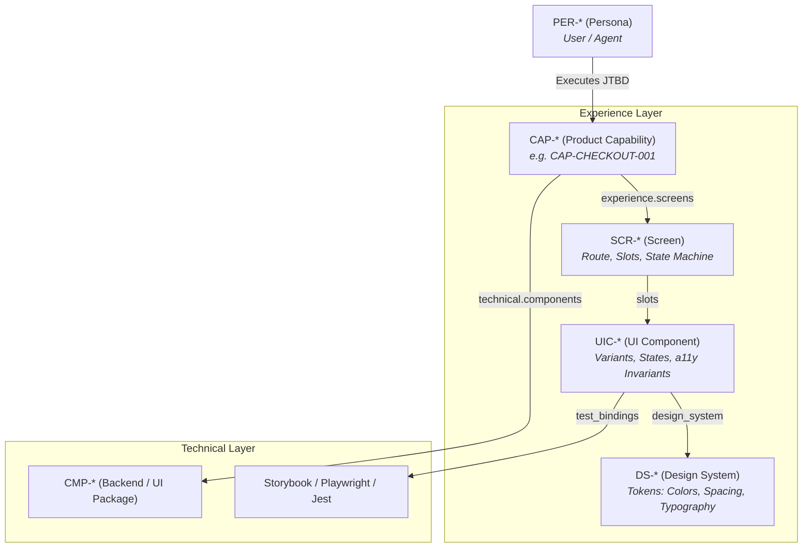

# Multi-Design Systems & UI Contracts

Frontend architecture frequently suffers from a severe disconnect: design tokens in Figma, UI components in React/Vue/Svelte, and product requirements in Jira drift apart over time. 

Eidos resolves this by establishing **Design as a First-Class Living Specification**, codifying **Multi-Design Systems (`DS-*`)**, **W3C Design Tokens**, **UI Component Manifests (`UIC-*`)**, and **Screen State Machines (`SCR-*`)** directly inside the repository under `eidos/design/`.

---

## 1. The Product-Experience-Technical Trinity

Eidos connects user needs, visual interface, and backend code in an unbroken chain:



Every user-facing capability in [`capability.schema.yaml`](schema-glossary.md#productcapability) declares an `experience:` block linking directly to screens, user flows, and design systems.

---

## 2. Multi-Design System Topology (`DS-*`)

Enterprise applications often require multi-brand, white-label, or multi-tenant theming. Eidos supports an **inheritance-based multi-design system hierarchy**:

```text
eidos/design/
├── systems/                          <- Multi-Design System catalog
│   ├── core/                         <- Base Design System
│   │   ├── system.adoc               <- type: design/system (id: DS-CORE)
│   │   ├── tokens.json               <- W3C tokens (base colors, spacing, typography)
│   │   └── components/               <- Canonical UI Component Manifests
│   │       ├── button.adoc           <- id: UIC-CORE-BUTTON
│   │       └── modal.adoc            <- id: UIC-CORE-MODAL
│   │
│   ├── acme/                         <- Client Acme White-Label Theme
│   │   ├── system.adoc               <- extends: "DS-CORE", client_id: "acme"
│   │   ├── tokens.json               <- Acme brand token overrides
│   │   └── components/               <- (Optional) Client-specific component overrides
│   │       └── header.adoc           <- implements: "UIC-CORE-HEADER"
│   │
│   └── globex/                       <- Client Globex Theme
│       ├── system.adoc               <- extends: "DS-CORE", client_id: "globex"
│       └── tokens.json
│
├── screens/                          <- Product Screens (SCR-*)
│   ├── checkout.adoc                 <- route: "/checkout", slots, states
│   └── dashboard.adoc
│
└── flows/                            <- User Interaction Flows (FLOW-*)
    └── onboarding.adoc
```

### Base System vs. Brand Extension

A base design system defines the complete foundational tokens and components. A client theme extends the base system and overrides only what is necessary:

```asciidoc
---
type: design/system
schema: schemas/v1/design/system.schema.yaml
id: DS-ACME
title: "Acme Enterprise Theme"
status: active
client_id: "acme"
extends_system: "DS-CORE"
tokens: "eidos/design/systems/acme/tokens.json"
---
= Design System: Acme Enterprise Theme

== Overview
Brand token overrides and specialized navigation components for Acme Corp enterprise deployment.
```

---

## 3. W3C DTCG Design Tokens (`tokens.json`)

All design tokens strictly adhere to the official **W3C Design Tokens Community Group (DTCG)** specification (`$value`, `$type`, `$description`). This ensures seamless export to Style Dictionary, Tailwind CSS, CSS variables, and Figma Token Studio.

### Base Tokens (`eidos/design/systems/core/tokens.json`):

```json
{
  "color": {
    "brand": {
      "primary": {
        "$value": "#0052cc",
        "$type": "color",
        "$description": "Primary brand action color"
      },
      "surface": {
        "$value": "#ffffff",
        "$type": "color"
      }
    }
  },
  "spacing": {
    "md": {
      "$value": "16px",
      "$type": "dimension"
    }
  },
  "border": {
    "radius": {
      "button": {
        "$value": "8px",
        "$type": "dimension"
      }
    }
  }
}
```

### Brand Token Override (`eidos/design/systems/acme/tokens.json`):

```json
{
  "color": {
    "brand": {
      "primary": {
        "$value": "#e63946",
        "$type": "color",
        "$description": "Acme corporate red override"
      }
    }
  }
}
```

---

## 4. UI Component Manifests (`UIC-*`)

UI Component manifests (`type: design/ui-component`) define the contract for a reusable visual component, including supported variants, interactive states, accessibility invariants, and automated test bindings.

### Component Manifest Example (`eidos/design/systems/core/components/button.adoc`):

```asciidoc
---
type: design/ui-component
schema: schemas/v1/design/ui-component.schema.yaml
id: UIC-CORE-BUTTON
title: "Action Button"
design_system: "DS-CORE"
status: active
category: inputs

variants:
  - name: "primary"
    description: "High-emphasis visual action."
  - name: "secondary"
    description: "Medium-emphasis alternative action."
  - name: "destructive"
    description: "Irreversible or critical operations."

states:
  - default
  - hover
  - active
  - focus
  - disabled
  - loading

accessibility:
  wcag_level: "AA"
  aria_role: "button"
  keyboard_nav: "Enter and Space trigger action; Tab traverses focus."

test_bindings:
  storybook: "packages/ui/src/Button.stories.tsx"
  unit_test: "packages/ui/src/Button.test.tsx"
---
= UI Component: Action Button
:toc: left

== States & Interaction Matrix
* **Loading State**: Displays inline spinner and disables pointer events.
* **Focus State**: Uses 2px solid brand focus ring with 2px offset.
```

---

## 5. Screen State Machines (`SCR-*`)

Screens (`type: design/screen`) bridge product capabilities with visual layout. They define the URL route, layout slots, supported design systems, and the screen state machine (loading, empty, active, error).

### Screen Specification Example (`eidos/design/screens/checkout.adoc`):

```asciidoc
---
type: design/screen
schema: schemas/v1/design/screen.schema.yaml
id: SCR-CHECKOUT
title: "Order Checkout Screen"
route: "/checkout"
status: active

capabilities:
  - "eidos/domains/checkout/capabilities/express-checkout.adoc"

supported_design_systems:
  - "eidos/design/systems/core/system.adoc"
  - "eidos/design/systems/acme/system.adoc"

slots:
  express_wallet: "UIC-*-WALLET-BUTTON"
  payment_form: "UIC-*-PAYMENT-FORM"
  cart_summary: "UIC-*-CART-SUMMARY"

states:
  - name: "loading"
    description: "Skeleton loader displayed during session retrieval."
  - name: "active"
    description: "Interactive form with active payment methods."
  - name: "error"
    description: "Error alert boundary for payment or network failures."
---
= Screen: Order Checkout
:toc: left

== Screen Responsibilities
Coordinates payment form submission, address validation, and express wallet integrations.
```

---

## 6. CLI Commands for Design

You can scaffold and manage design systems, components, and screens directly from the command line:

```bash
# 1. Scaffold base design system:
eidos spec create design-system DS-CORE --title "Core Product Design System"

# 2. Scaffold a client theme extending the core:
eidos spec create design-system DS-ACME --title "Acme Enterprise Theme" \
  --client acme --extends DS-CORE

# 3. Scaffold a UI component:
eidos spec create ui-component UIC-CORE-BUTTON --title "Primary Action Button" \
  --system DS-CORE

# 4. Scaffold a client-specific component override:
eidos spec create ui-component UIC-ACME-HEADER --title "Acme Corporate Header" \
  --system DS-ACME --implements UIC-CORE-HEADER

# 5. Scaffold a product screen:
eidos spec create screen SCR-CHECKOUT --title "Order Checkout Screen" \
  --route "/checkout"
```

---

## 7. Interactive Living Portal & Token Studio

When running the interactive Living Web Portal:

```bash
eidos serve --path eidos --port 8080
```

The portal compiles all W3C Design Tokens into an interactive **Token Studio**, allowing engineers, designers, and AI agents to:
* Inspect color palettes, spacing ramps, and typography scales across active themes.
* Compare base tokens against client theme overrides in real time.
* Inspect UI component state matrices and accessibility criteria.

