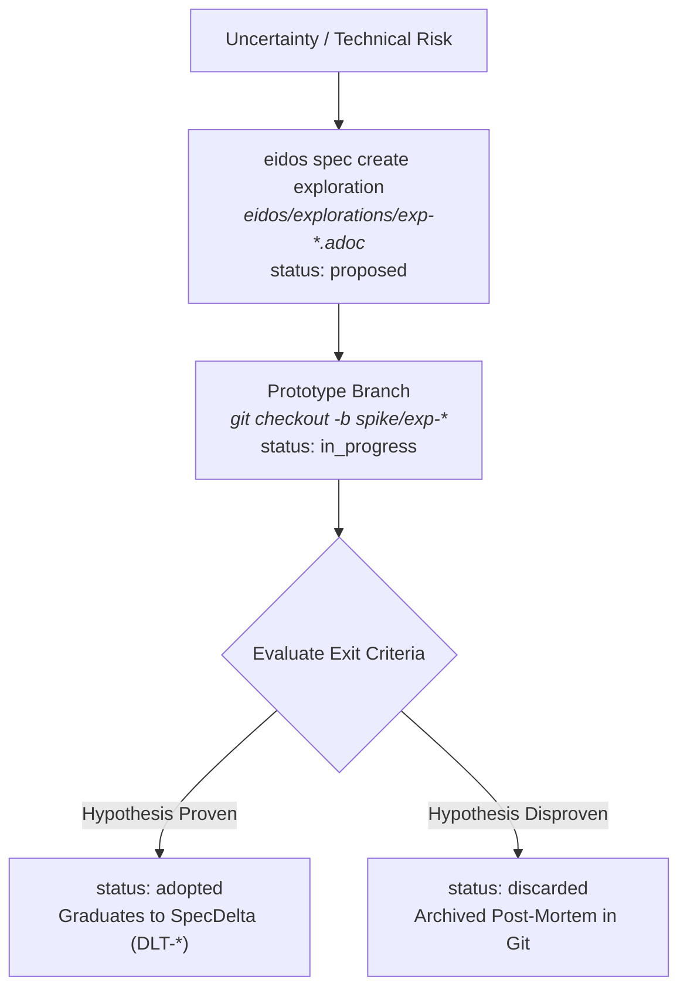

# Explorations & Technical Spikes (`EXP-*`)

In modern software development, teams often face critical unknowns: *Will this embedded database meet our latency targets? Can this messaging queue handle 50k events/sec? Does this library support our edge deployment target?*

Traditional teams handle these questions with ad-hoc "spikes". But traditional spikes suffer from two dangerous extremes:
1. **The Write-Only Spike**: An engineer tests an idea on a local branch, learns it fails, and deletes it. Six months later, another engineer or AI agent repeats the exact same failed experiment because zero learnings were preserved.
2. **The Leaking Prototype**: A quick prototype written for a spike gets merged into production because "it works", bringing unverified architectural shortcuts into the core codebase.

Eidos solves this through **Explorations (`EXP-*`)**: schema-validated, hypothesis-driven spike artifacts that live in Git under `eidos/explorations/`.

---

## 1. The Exploration Lifecycle

Explorations follow a strict, auditable lifecycle:



### Lifecycle States (`exploration.schema.yaml`):

| State | Meaning | Next Step |
| :--- | :--- | :--- |
| **`draft` / `proposed` / `planned`** | A technical question, hypothesis, and exit criteria are queued for research. | Engineer or agent checks out prototype branch. |
| **`in_progress`** | Experimental code and benchmarks are actively being executed in a spike branch. | Record empirical metrics (p99 latency, memory, ops/sec). |
| **`adopted`** | The hypothesis is verified; the spike proved feasible and met all exit criteria. | Graduate to a production **SpecDelta (`DLT-*`)** and link via `decision.resulting_delta_id` and `DEC-*` `graduated_from`. |
| **`discarded`** | The hypothesis failed or the approach was deemed infeasible. | Document failure reasons under `decision.learnings` and archive in Git. |

---

## 2. Anatomy of an Exploration Manifest

Exploration documents live in `eidos/explorations/exp-<year>-<num>.adoc` (or `EXP-<YEAR>-<NUM>.adoc`):

```asciidoc
---
type: product/exploration
schema: schemas/v1/product/exploration.schema.yaml
id: EXP-2026-001
title: "Evaluate SQLite in WAL Mode for Edge Node Caching"
status: adopted # draft | proposed | planned | in_progress | adopted | discarded

hypothesis: "Adopting SQLite with WAL mode and memory-mapped I/O will reduce cache read latency by 60% compared to local Redis, while eliminating external daemon dependencies."

questions_to_answer:
  - "Does SQLite in WAL mode handle 50 concurrent readers without database locking errors?"
  - "What is the memory footprint under a 500MB working set size?"
  - "How clean is cross-platform compilation across Alpine Linux and macOS ARM64?"

spikes_to_run:
  - name: "spike-concurrency-benchmark"
    target: "Simulate 50 concurrent reader threads executing 100k read operations against a 500MB database."
  - name: "spike-container-build"
    target: "Verify automated static linking inside minimal Docker scratch image."

exit_criteria:
  max_duration: "3_days"
  benchmark: "P99 read latency < 5ms under 50 concurrent readers with zero locking exceptions."

decision:
  outcome: adopted # adopted | discarded | pivoted
  resulting_delta_id: DLT-2026-010
  learnings: "SQLite WAL mode achieved 1.4ms p99 read latency across 50 threads with 42MB RSS memory."
---
= Exploration: Evaluate SQLite in WAL Mode for Edge Node Caching
:toc: left

== Problem Statement
Our current edge daemon requires Redis running as a sidecar, increasing memory overhead on constrained edge gateways. We need a reliable embedded solution.

== Investigation Log & Findings
*(Record benchmark numbers, profiling traces, and findings here as the spike progresses).*

== Final Decision & Rationale
*(Record outcome and justification when concluding the exploration).*
```

---

## 3. The 5-Step Exploration Protocol

### Step 1: Scaffold the Exploration
Create the exploration document using the Eidos CLI:

```bash
eidos spec create exploration EXP-2026-001 \
  --title "Evaluate SQLite in WAL Mode for Edge Node Caching" \
  --motivation "Assess whether SQLite WAL mode can sustain 10k reads/sec with under 5ms p99 latency."
```

Validate the new spec:
```bash
eidos validate eidos
```

### Step 2: Branch & Prototype
Create an isolated Git branch:
```bash
git checkout -b spike/exp-2026-001
```

Implement the prototype or benchmark in a scratch directory (e.g., `scratch/`). Never mix exploratory prototype code into production source directories (`src/`).

### Step 3: Record Empirical Data
Document concrete, verifiable numbers directly in the AsciiDoc body:
* Throughput (requests/sec)
* Latency percentiles (p50, p95, p99)
* Memory footprint and CPU utilization
* Operational friction (build complexity, dependencies)

### Step 4: Resolve Outcome

#### Path A: Hypothesis Proven -> Graduate to SpecDelta & Embedded Decision
1. Update frontmatter `status: adopted` and populate the `decision:` block:
   ```yaml
   status: adopted
   decision:
     outcome: adopted
     resulting_delta_id: DLT-2026-010
     learnings: "Proven sub-2ms p99 read latency in WAL mode with zero locking contention."
   ```
2. Scaffold a formal SpecDelta to plan the production integration:
   ```bash
   eidos delta create DLT-2026-010 \
     --title "Integrate SQLite WAL Cache Engine" \
     --kind feature \
     --motivation "Graduated from validated spike EXP-2026-001."
   ```
3. Record the enduring architectural trade-off in the target container's `decisions:` block with `graduated_from: EXP-2026-001`, and implement clean, production-ready code under the SpecDelta checklist.

#### Path B: Hypothesis Disproven -> Archive Institutional Knowledge
1. Update frontmatter `status: discarded` and populate `decision.learnings`:
   ```yaml
   status: discarded
   decision:
     outcome: discarded
     learnings: "SQLite write-lock contention caused 80% latency degradation under 50 concurrent writers."
   ```
2. Document the exact reasons for failure in the `Final Decision & Rationale` section.
3. Merge the exploration document to `main`. **The failure is preserved as permanent architectural knowledge**, preventing future team members and AI agents from repeating the experiment.

### Step 5: Verification Gate
Always ensure the repository passes validation before merging:
```bash
eidos validate eidos
eidos drift
```

---

## 4. How AI Agents Use Explorations

When using the [`eidos-plan`](../guides/agent-plugin.md#assistant-integration-guides) agent skill:
* Autonomous coding agents will refuse to make sweeping architectural gambles without first proposing an `EXP-*`.
* Agents run benchmark scripts in isolated workspaces, capture output into the exploration log, and summarize findings for human review.
* If a human rejects an approach, the agent marks the exploration `discarded` and registers the negative constraint so future agent prompts never re-propose it.
