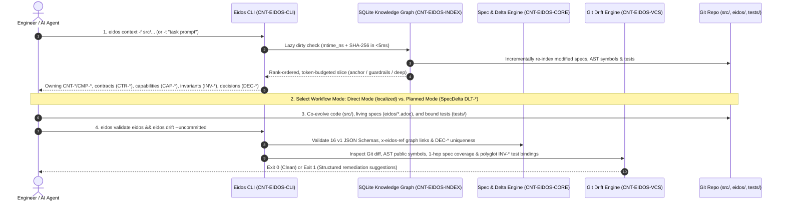
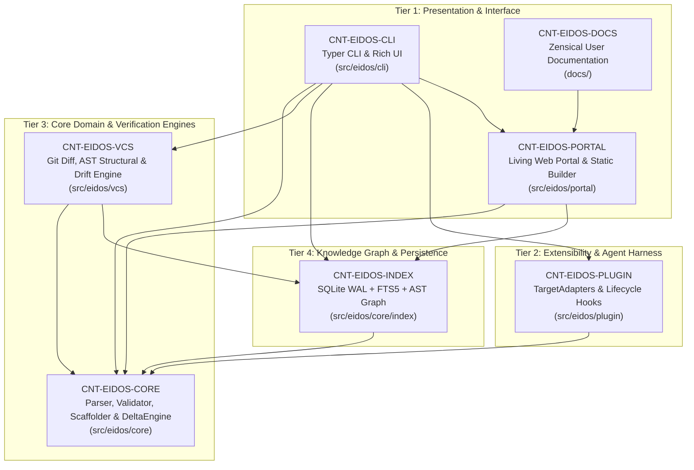
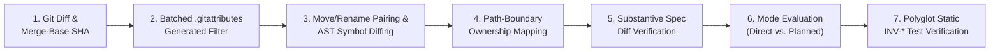

# How Eidos Works: Architecture & Engine Internals

Eidos is not a passive documentation generator or an LLM wrapper—it is a **100% deterministic, Git-native software architecture and lifecycle engine (`POL-004`)**. Every query, schema validation, context slice, and drift check runs locally in milliseconds with zero external AI calls and zero background daemons.

This guide explains how Eidos works under the hood across its end-to-end execution loop and six core engine subsystems.

---

## 1. The End-to-End Eidos Execution Loop

When a human engineer or an autonomous AI coding agent works in an Eidos-governed repository, every change flows through a deterministic 4-stage feedback loop:

### Why This Loop Eliminates Architectural Drift
1. **Before Writing Code (Context Slicing)**: Instead of stuffing thousands of lines of raw markdown into an LLM context window, `eidos context` queries the embedded SQLite knowledge graph (`eidos/.cache/index.db`) and extracts only the exact containers, components, contracts, active invariants, and historical design decisions (`DEC-*`) governing the target files or task.
2. **During Implementation (Dual Workflow Co-Evolution)**:
   * **Direct Mode**: For bug fixes and single-container refactors, engineers and agents update code, tests, and the owning `.adoc` specification in the same commit.
   * **Planned Mode**: For cross-container features, new containers, or breaking contract changes, changes are declared upfront in a **SpecDelta (`DLT-*`)** with verifiable `mutations:` and `expect:` post-conditions.
3. **Before Completion (Deterministic Gate & Lifecycle Hooks)**: `eidos validate` and `eidos drift` verify that every schema is valid, every cross-reference resolves, every modified code package is backed by a substantive specification update, and every capability invariant (`INV-*`) is bound to a real test function.

---

## 2. System Container Topology (Dogfooded C4 Level 2)

Eidos uses its own specification standard to govern itself. The engine is organized as a modular monorepo with **7 C4 Level 2 Containers** across 4 architectural tiers:

---

## 3. Subsystem Deep Dive

### 3.1 Specification Parser & Schema Validator (`CNT-EIDOS-CORE`)

Every living specification in `eidos/` is an AsciiDoc (`.adoc`) file headed by a YAML frontmatter block (`--- ... ---`). When `eidos validate` runs, `SpecParser` and `SpecValidator` execute a **two-pass validation pipeline**:

#### Pass 1: Schema Validation with Shared `$defs` & SQLite Caching
1. **Frontmatter Extraction**: `SpecParser` splits the `.adoc` file into structured YAML frontmatter metadata, raw YAML line offsets, and AsciiDoc prose body.
2. **Shared Definition Injection**: `SpecValidator` loads the canonical JSON/YAML schema referenced by `schema:` from `assets/schemas/v1/` (16 document types across `product/*`, `tech/*`, `design/*`, and `delta/*`) and merges reusable definitions from `assets/schemas/v1/common/defs.yaml`:
   * `#/$defs/decision`: Enforces structure on in-place architectural decisions (`DEC-*`, `title`, `decision`, `rationale`, `rejected_alternatives`, `graduated_from`).
   * `#/$defs/invariant` & `#/$defs/test_bound_invariant`: Enforces RFC 2119 rules and `test_binding` paths on invariants (`INV-*`).
3. **Content-Hashed Validation Cache (`spec_validation_cache`)**: Validation results are keyed by repo-relative path and SHA-256 content hash inside `eidos/.cache/index.db`. Unchanged specifications skip JSON Schema re-evaluation on subsequent runs.

#### Pass 2: Cross-Document Graph Integrity (`x-eidos-ref`) & Architectural Laws
After individual documents validate against their JSON Schema, `SpecValidator` verifies global graph invariants across the entire catalog:
* **Entity ID & Decision Uniqueness**: Ensures zero duplicate document IDs (`CNT-*`, `CMP-*`, `CAP-*`, etc.) and zero duplicate `DEC-*` decision IDs across the repository.
* **Schema-Driven Reference Resolution (`x-eidos-ref`)**: Schemas annotate reference fields with `x-eidos-ref: {prefixes: [...], target_types: [...]}`. The validator checks that every referenced ID or file path resolves to an existing catalog entity of the exact expected type (for example, preventing a `CNT-*` container field from pointing to an inline `CMP-*` component).
* **Centralized Component Governance**:
  * `INV-COMPONENT-CENTRALIZATION-MANDATE`: Dedicated `tech/component` files must reside under `eidos/architecture/components/` and never inside implementation directories (`src/`, `packages/`).
  * `INV-COMPONENT-CONTAINER-AFFINITY`: Every promoted `CMP-*` component must bind to an existing parent `CNT-*` container via `container:`.
  * `INV-INTERFACE-BOUNDARY-GOVERNANCE`: Containers (`CNT-*`) own cross-process boundary contracts (`CTR-*`), whereas components (`CMP-*`) declare in-process language signatures via `interfaces.provides`.

---

### 3.2 Embedded SQLite Knowledge Graph & Context Slicer (`CNT-EIDOS-INDEX`)

To provide sub-millisecond retrieval without external databases or embedding APIs, `CNT-EIDOS-INDEX` maintains an embedded SQLite 3 database in WAL (Write-Ahead Logging) mode at `eidos/.cache/index.db`.

The index engine is decomposed into 5 focused modules under `src/eidos/core/index/`:

| Module | Component ID | Responsibility |
| :--- | :--- | :--- |
| `storage.py` | `CMP-GRAPH-STORAGE` | Canonical authority for `SCHEMA_VERSION` (`2.3.0`), DDL initialization, WAL pragmas, automatic drop-and-rebuild migration on version mismatch, and corruption recovery. |
| `sync.py` | `CMP-INCREMENTAL-SYNC-ENGINE` | Two-tier `mtime_ns` + `SHA-256` dirty detection, path-keyed entity eviction on ID rename, edge reconstruction, and source ownership reconciliation. |
| `query.py` | `CMP-FTS-QUERY-ENGINE` & `CMP-GRAPH-TRAVERSAL-ENGINE` | Positional column-weighted FTS5 BM25 search, identifier de-compounding, symbol lookup, and recursive CTE `k`-hop blast-radius traversal. |
| `context.py` | `CMP-TIERED-CONTEXT-COMPRESSOR` | Rank-ordered, token-budgeted context slicing across `anchor` (`<=300` tokens), `guardrails` (`<=1000` tokens), and `deep` (`<=2500` tokens) tiers. |
| `ast_indexer.py` | `CMP-AST-SYMBOL-INDEXER` | Polyglot AST extraction via `ast-grep-py` (with `python-ast` fallback) across Python, TS/JS, Go, Rust, Java, and Kotlin. |

#### Relational & Lexical Schema (`eidos/.cache/index.db`)
The SQLite database manages 8 coordinated tables:
1. **`entities`**: All parsed specification nodes (`SYS-*`, `DOM-*`, `CAP-*`, `POL-*`, `PER-*`, `EXP-*`, `ARCH-*`, `CNT-*`, `CMP-*`, `CTR-*`, `DS-*`, `UIC-*`, `SCR-*`, `CLT-*`, `FLOW-*`, `DLT-*`, plus child `INV-*` nodes) with JSON metadata and body prose.
2. **`edges`**: Directed architectural relationships (`depends_on`, `provides`, `consumes`, `governs`, `asserts`, `implements`, `contains`, `affects`).
3. **`indexed_files`**: Tracks `file_path`, `doc_id`, `mtime_ns`, `sha256`, and `file_kind` (`spec`, `code`, `test`) for incremental synchronization.
4. **`symbol_mappings`**: Maps file paths, globs, and symbols to owning `CNT-*` and `CMP-*` entities using specificity precedence.
5. **`code_symbols`**: Persists AST-extracted classes, functions, methods, structs, interfaces, line coordinates (`line_start`, `line_end`), and signatures.
6. **`specs_fts`**: SQLite FTS5 virtual table indexing `entity_id` (`UNINDEXED`), `title`, `jtbd_or_rule`, `body_text`, `keywords`, and de-compounded `symbols`.
7. **`spec_validation_cache`**: Content-addressed cache of per-file JSON Schema validation verdicts.
8. **`test_binding_cache`**: Content-addressed cache of AST-extracted test functions (`func` and `Class::method`) and referenced `INV-*` IDs per test file.

#### How Lazy Incremental Sync Works (`<5ms`)
Before every CLI query (`eidos context`, `eidos index`, `eidos spec list`), `_ensure_synced()` runs `check_index_dirty()`:
1. Walks `eidos/`, `tests/`, and every container's declared `package_path`.
2. If a file's `mtime_ns` matches `indexed_files`, it is skipped immediately without reading bytes from disk.
3. If `mtime_ns` changed, Eidos computes the file's `SHA-256`. If the hash matches the stored hash (e.g., after `git checkout` or `touch`), Eidos refreshes `mtime_ns` in-place without re-indexing.
4. Only genuinely modified, added, or deleted files are re-parsed. If a specification's `id:` was renamed in-place, `sync.py` evicts the old `doc_id` keyed by `file_path` so ghost entities and orphan edges never linger.

#### How Lexical Retrieval & Tiered Context Slicing Work
When an agent runs `eidos context -t "rate limiting and token expiration" --tier guardrails`:
1. **Identifier De-Compounding**: Query tokens like `detect_drift` or `ArchitecturalIndex` are split into both exact and sub-word tokens (`detect`, `drift`, `architectural`, `index`).
2. **SQL-Scoped FTS5 Ranking**: `specs_fts` is queried using positional BM25 weights `bm25(specs_fts, 0.0, 4.0, 2.0, 1.0, 2.0, 2.0)` (`title` weighted 4x, `jtbd_or_rule`/`keywords`/`symbols` 2x, `body_text` 1x). Historical `delta/mutation` and `product/exploration` records are filtered out *inside SQL before `LIMIT`* so active architecture entities are never crowded out.
3. **1-Hop Graph Expansion**: Matched domains (`DOM-*`), capabilities (`CAP-*`), or invariants (`INV-*`) automatically expand across `edges` to pull in their realizing containers (`CNT-*`), components (`CMP-*`), contracts (`CTR-*`), and governing policies (`POL-*`).
4. **Rank-Ordered Token Budgeting**: `TieredContextCompressor` serializes the subgraph into Markdown or JSON while strictly enforcing the tier's token ceiling (`anchor <= 300`, `guardrails <= 1000`, `deep <= 2500` tokens), rendering compact 1-line `DEC-*` summaries in `anchor` and full rationale/rejected alternatives in `guardrails` and `deep`.

---

### 3.3 Git-Native Drift Detection Engine (`CNT-EIDOS-VCS`)

`eidos drift` is the primary verification gate ensuring that code, specifications, and tests never diverge. Located in `src/eidos/vcs/` (`drift.py`, `diff.py`, `structural.py`, `invariants.py`, `report.py`), it executes a **7-step deterministic verification pipeline**:

1. **Fail-Closed Base Ref & Merge-Base Resolution (`diff.py`)**:
   * In branch mode (`--base origin/main`), Eidos resolves the exact merge-base SHA (`git merge-base`) for 3-dot diffs (`base...HEAD`) and reads baseline file contents directly from that commit SHA. If an explicit `--base` ref does not exist, Eidos fails closed with an error instead of silently falling back to `--uncommitted`.
   * In working-tree mode (`--uncommitted`), Eidos inspects both staged and unstaged changes plus untracked files against `HEAD`.
2. **Batched Generated/Vendored Filtering (`project.py`)**:
   * Candidate code paths are passed in a single batched `git check-attr linguist-generated linguist-vendored` call. Generated bundles (such as `assets/portal/bundle.html.gz`) are automatically excluded from code drift.
3. **Content-Based Move Pairing & Structural AST Diffing (`structural.py`)**:
   * Deleted and added files are paired by content and public symbol overlap to recognize file moves/renames without relying on Git rename heuristics.
   * For modified code files, `AstSymbolIndexer` compares public AST symbols (classes, functions, method signatures) between the baseline version and current working tree.
   * If a code change only touches internal implementation comments, docstrings, or local variables without adding/modifying/removing public symbols or files, Eidos classifies it as a non-structural edit.
4. **Strict Path-Boundary Ownership Mapping**:
   * Every modified source file is mapped to its owning C4 component (`CMP-*` via `source_path`) and C4 container (`CNT-*` via `package_path`).
   * **Unowned Code Detection**: If a structural code file is added or modified outside any declared `package_path`/`source_path`, `eidos drift` flags it as **unowned code drift** unless claimed by a container/component or covered by a substantive root `system.adoc` / `system-architecture.adoc` update.
5. **Substantive Spec Diff Enforcement (Anti-Gaming Gate)**:
   * To prevent agents or developers from bypassing drift checks by adding a blank line or comment to a `.adoc` file, `StructuralChangeInspector.is_substantive()` normalizes specification diffs by stripping AsciiDoc comments (`//`), YAML comments (`#`), and whitespace.
   * Structural code changes whose only accompanying spec edit is whitespace or comments are flagged under `trivially_covered_files` (`rule: trivial_spec_diff`) and fail the drift check.
6. **Workflow Mode & 1-Hop Neighborhood Evaluation**:
   * **Planned Mode** (when an active `DLT-*` SpecDelta is modified in the diff): Verifies that all touched containers and components are declared in the active SpecDelta's `mutations`, `affects`, or `blast_radius`.
   * **Direct Mode** (no active `DLT-*` in diff): Verifies that for every touched container/component with structural changes, either its own `.adoc` specification or a specification within its **component-scoped 1-hop knowledge graph neighborhood** (`CAP-*`, `CTR-*`, `CNT-*`, `CMP-*`—explicitly excluding global `POL-*` and `PER-*` edges so editing one policy never rubber-stamps the whole repo) was substantively updated.
7. **Polyglot Static Invariant Test Verification (`invariants.py`)**:
   * Scans every `INV-*` invariant across capabilities (`CAP-*`), policies (`POL-*`), and promoted components (`CMP-*`).
   * Uses `test_binding_cache` and `ast-grep` across **Python (`.py`), TypeScript/JavaScript (`.ts`, `.tsx`, `.js`, `.jsx`), Go (`_test.go`), Rust (`.rs`), Java (`.java`), and Kotlin (`.kt`, `.kts`)** to verify that:
     1. The file in `test_binding: path/to/test_file::test_func` (or `path/to/test_file::TestClass::test_method`) exists.
     2. The target test function or method is defined in the AST.
     3. The test body, docstring, decorator, or comment explicitly references the `INV-*` ID.

---

### 3.4 SpecDelta Engine, Deterministic Execution & Tombstone Auditor (`CNT-EIDOS-CORE`)

In **Planned Mode**, architectural changes are governed by **SpecDeltas (`eidos/deltas/dlt-yyyy-nnn.adoc`)** managed by `DeltaEngine` (`delta_engine.py`), `DeltaAuditor` (`audit.py`), and `ChangelogGenerator` (`changelog.py`):

* **44 Typed Semantic Mutations**: Each SpecDelta declares an ordered `mutations:` array using strict action verbs (`add_container`, `modify_container`, `remove_container`, `add_component`, `modify_component`, `add_capability`, `patch_invariant`, `modify_contract`, etc.).
* **Declarative Post-Conditions (`expect:`)**: Mutations can specify `expect: {contains: "...", status: "active", ...}`. Running `eidos delta verify <ID>` checks both that target entities exist (or are absent for `remove_*` actions) and that all `expect:` assertions hold on the live specifications.
* **Transactional LLM-Free Execution (`eidos delta apply <ID> --execute`)**: `DeltaEngine` snapshots baseline files in SQLite (with Git history fallback), deterministically scaffolds missing specifications or applies structural frontmatter mutations, runs `SpecValidator` pre-commit checks, and atomically rolls back all file writes and symlinks if any validation error occurs.
* **Reverse-Dependency Tombstone Auditing (`eidos delta audit <ID>`)**: When a SpecDelta removes or deprecates an entity, `DeltaAuditor` scans the entire repository (`eidos/`, `src/`, `tests/`, `docs/`) for lingering references and classifies every hit into:
  * **Approved References**: Historical `DLT-*` / `EXP-*` logs, negative assertions in tests, cleanup routines, or paths matching explicit `tombstone.allowed_reasons` regexes.
  * **Active Leaks**: Unacknowledged live references that would cause runtime or architectural breakage (`--strict` exits with code `1`).
* **Gitignored Symlink Views & Changelog Compilation**: SpecDeltas live flat in `eidos/deltas/` (preventing broken Git history links when status changes) while `eidos delta sync-views` maintains gitignored symlinks under `eidos/deltas/by-status/<status>/`. `eidos delta changelog` combines Git release tags with applied SpecDeltas (`intent.kind` and `mutations[].action`) to compile a Keep a Changelog compliant `CHANGELOG.md` and `docs/changelog.md`.

---

### 3.5 Agent Plugin Harnesses & Block-Once Lifecycle Hooks (`CNT-EIDOS-PLUGIN`)

Eidos integrates with AI coding assistants through a declarative `TargetAdapter` pipeline (`src/eidos/plugin/installer.py`) and CLI-native lifecycle hooks (`src/eidos/plugin/hooks.py`):

1. **Manifest-Tracked Multi-Harness Projection (`eidos plugin install`)**:
   * Projects the canonical plugin (`assets/plugin_reference/`) and **4 cohesive Agent Skills** (`eidos`, `eidos-spec`, `eidos-plan`, `eidos-ops`) into `.agents/plugins/eidos/`, `.claude/`, `.cursor/`, `.github/`, `.aider/`, `.cline/`, `.opencode/`, and `.codex/`.
   * Records SHA-256 file digests in `.eidos-manifest.json` so `eidos plugin update` and `eidos plugin uninstall` never clobber user-owned files or custom instructions.
2. **Cross-Harness Hook Normalization (`eidos hook lint` & `eidos hook drift`)**:
   * AI coding harnesses emit different JSON payloads on `stdin` for lifecycle events (`PreToolUse`, `PostToolUse`, `PostInvocation`, `Stop`). `HookRunner` normalizes payloads across Antigravity, Claude Code, Cursor, Cline, OpenCode, and Codex.
   * **`eidos hook lint`**: Intercepts file writes (`PreToolUse` / `PostToolUse`) to block unauthorized ADR creation (`docs/adr/`, `ADR-*.md`) and validate modified `.adoc` schemas immediately.
   * **`eidos hook drift` (Block-Once Stop Gate)**: When an AI agent attempts to finish its turn (`Stop` event), `eidos hook drift --event stop` runs drift detection on the working tree. If drift or schema errors exist, it blocks completion and returns structured remediation instructions to the agent. To prevent infinite retry loops if an agent is genuinely stuck, Eidos computes a SHA-256 fingerprint of the drift state in `eidos/.cache/stop-gate.json`—blocking once per unique diff state and allowing stop if the exact same state is encountered consecutively.

---

### 3.6 Air-Gapped Living Web Portal (`CNT-EIDOS-PORTAL`)

The interactive Living Web Portal (`eidos portal serve` and `eidos portal build`) compiles all 16 specification types and the SQLite knowledge graph into a single-page visual architecture explorer:

* **Zero Node.js Runtime Dependency (`INV-PORTAL-ZERO-NODE-DEP`)**: The frontend (React 19, Tailwind CSS v4, Material Design 3, Mermaid.js v11, and `@asciidoctor/core`) is pre-compiled at package build time into a deterministic gzip-compressed asset (`assets/portal/bundle.html.gz`, `<5 MiB` uncompressed budget).
* **100% Air-Gapped Bundle (`INV-PORTAL-AIR-GAPPED-BUNDLE`)**: All scripts, stylesheets, and Geist/Geist Mono `woff2` fonts are embedded inline. The generated portal makes zero requests to external CDNs, working offline and over `file://` or internal corporate networks.
* **Hierarchical C4 Drill-Down (`INV-PORTAL-INTERACTIVE-C4`)**: `PortalGenerator` synthesizes C4 Level 1 System Context, tiered Level 2 Container diagrams with explicit dependency edges, and clickable Level 3 Component Whitebox views with slide-over inspection of in-process APIs, invariants, and embedded `DEC-*` decisions.
