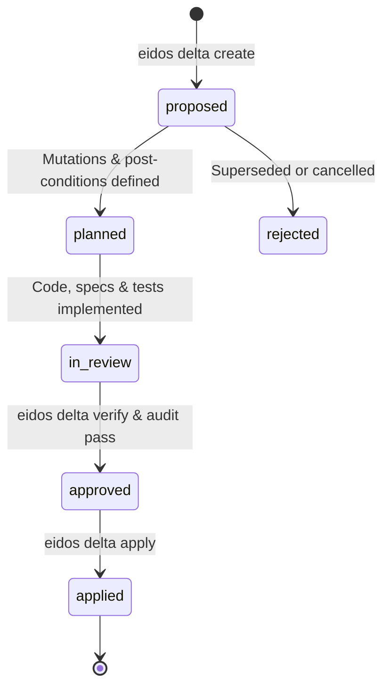

# SpecDeltas (DLT-*)

When architecture needs to change, how do you track the change without creating dead ADRs? Eidos uses **SpecDeltas**.

A **SpecDelta** is a semantic mutation artifact describing an architectural change, why it was made, which living specifications were updated, and which tests verify it.

---

## Dual Workflows: Direct Mode vs. Planned Mode

Eidos recognizes that software development cannot be burdened by ceremony for every localized fix. It enforces **Dual Workflows (`POL-003`)**:

| Mode | When to Use | How It Works |
| :--- | :--- | :--- |
| **Direct Mode** *(Default for localized changes)* | Bug fixes, single-container refactors, adding an internal helper or non-breaking CLI flag, test/doc updates | Co-evolve code in `src/`, tests in `tests/`, and living specs in `eidos/` directly in the same commit. `eidos drift` verifies that touched components or their 1-hop knowledge graph neighborhood have substantive spec updates. |
| **Planned Mode** *(SpecDelta Lifecycle)* | New C4 containers (`CNT-*`), breaking contract (`CTR-*`) changes, cross-domain features, new policies (`POL-*`), deprecations/removals | Author a formal SpecDelta (`DLT-*`) declaring `intent` and `mutations` (with `expect.body` / `expect.frontmatter` post-conditions; scope and downstream blast radius are derived automatically from the knowledge graph). Implement code and spec changes, verify with `eidos delta verify`, audit removals with `eidos delta audit`, and reconcile via `eidos delta apply`. |

---

## The SpecDelta Mutation Lifecycle (Planned Mode)



All SpecDeltas reside in **flat storage** under `eidos/deltas/dlt-yyyy-nnn.adoc` so file paths never break across Git commits when statuses change. Eidos automatically maintains gitignored symlink projections grouped by lifecycle state (`draft`, `proposed`, `planned`, `in_review`, `approved`, `applied`, `rejected`) inside `eidos/deltas/by-status/`.

---

## Anatomy of a SpecDelta (`delta.schema.yaml`)

A SpecDelta document (`eidos/deltas/dlt-2026-051.adoc`) combines strongly-typed YAML frontmatter with human-readable architectural rationale:

```asciidoc
---
type: delta/mutation
schema: schemas/v1/delta/delta.schema.yaml
id: DLT-2026-051
title: "Close Spec-to-Code Drift Detection Bypasses for Unowned Code and 1-Hop Neighborhoods"
status: applied # draft | proposed | planned | in_review | approved | applied | rejected

intent:
  kind: bug # feature | enabler | bug
  bug_classification: spec_violation # spec_violation | spec_gap (for kind: bug)
  severity: high # low | medium | high | critical
  motivation: "Eliminate spec-to-code drift bypasses where unowned source files pass or trivial whitespace spec edits satisfy coverage."

mutations:
  - action: modify_container
    target_container: "CNT-EIDOS-VCS"
    details: "Harden CMP-DRIFT-DETECTOR in src/eidos/vcs/drift.py to flag unowned structural code files and enforce substantive spec diffs."
    expect:
      body:
        contains:
          - "CMP-DRIFT-DETECTOR"
  - action: add_invariant
    target_capability: "CAP-VCS-001"
    target_invariant_id: "INV-VCS-UNOWNED-CODE-DRIFT"
    details: "Require unowned structural code files to trigger drift unless claimed by a container/component."

tombstone:
  search_tokens:
    - "legacy_drift_fallback"
  allowed_reasons:
    - path: "tests/test_drift.py"
      reason: "Negative regression test verifying legacy fallback is rejected."

vcs:
  base_commit: "a1b2c3d"
  branch: "fix/drift-unowned-code"
  pull_request: "#51"
---
= SpecDelta: Close Spec-to-Code Drift Detection Bypasses

== Rationale & Context
Previously, modifying an unowned source file could pass drift checks if an unrelated specification was edited in the same commit.

== Verification Checklist
* [x] `eidos delta verify DLT-2026-051` passes.
* [x] `eidos validate eidos && eidos drift --uncommitted` exits `0`.
```

---

## How the SpecDelta Engine Works Under the Hood

1. **44 Typed Semantic Mutation Actions (`mutations[].action`)**:
   Every mutation targets a specific layer of the living architecture:
   * **Product & Governance**: `add_domain`, `modify_domain`, `remove_domain`, `add_capability`, `extend_capability`, `modify_capability`, `deprecate_capability`, `remove_capability`, `add_persona`, `modify_persona`, `remove_persona`, `add_policy`, `modify_policy`, `patch_policy`, `deprecate_policy`, `remove_policy`, `add_invariant`, `patch_invariant`, `remove_invariant`.
   * **Technical Architecture**: `modify_architecture`, `add_container`, `modify_container`, `remove_container`, `add_component`, `modify_component`, `remove_component`, `add_contract`, `modify_contract`, `remove_contract`.
   * **Design & Experience**: `add_design_system`, `modify_design_system`, `remove_design_system`, `add_ui_component`, `modify_ui_component`, `remove_ui_component`, `add_screen`, `modify_screen`, `remove_screen`, `add_client`, `modify_client`, `remove_client`, `add_flow`, `modify_flow`, `remove_flow`.
2. **Declarative Post-Conditions (`expect:`) & Verification (`eidos delta verify`)**:
   Each mutation item can include a structured `expect:` block asserting `frontmatter:` properties (with list-subset matching) and/or `body:` substrings (`contains` / `not_contains`, evaluated after stripping AsciiDoc comments) on the target spec after implementation. `eidos delta verify <ID>` deterministically verifies that `add_*`/`modify_*` targets exist and were substantively updated relative to `vcs.base_commit`, `remove_*` targets are deleted, and all `expect:` assertions pass.
3. **Transactional Execution (`eidos delta apply --execute`)**:
   When `--execute` is passed, `DeltaEngine` snapshots baseline files into SQLite (with Git history fallback), scaffolds missing specifications or applies frontmatter mutations without LLMs, runs `SpecValidator` across the catalog, and atomically rolls back all file writes if any validation check fails.
4. **Reverse-Dependency Tombstone Auditing (`eidos delta audit`)**:
   When a SpecDelta removes or deprecates an entity, `DeltaAuditor` scans all specs, code, tests, and docs for lingering references, separating **approved references** (historical deltas/explorations, negative tests, or `tombstone.allowed_reasons`) from **unacknowledged active leaks**.
5. **Automated Changelog Compilation (`eidos delta changelog`)**:
   `ChangelogGenerator` combines Git release tags (`v*.*.*`) with applied SpecDeltas (classified via `intent.kind` and `mutations[].action`) to generate a Keep a Changelog compliant `CHANGELOG.md` and `docs/changelog.md`.

---

## CLI Commands for SpecDeltas

```bash
# 1. Scaffold a new SpecDelta (kind: feature | enabler | bug)
eidos delta create DLT-2026-055 \
  --title "Add Rate Limiting Contract" \
  --kind feature \
  --motivation "Protect public API endpoints from burst traffic." \
  --branch feat/rate-limiting

# 2. List all SpecDeltas or view the lifecycle dashboard
eidos delta list
eidos delta status

# 3. Verify all declared mutations and expect: post-conditions
eidos delta verify DLT-2026-055 --json

# 4. Audit removed/deprecated entities for dangling references
eidos delta audit DLT-2026-055 --strict

# 5. Reconcile and apply the SpecDelta in-place (optional --execute or --verify)
eidos delta apply DLT-2026-055 --verify

# 6. Compile CHANGELOG.md and docs/changelog.md from applied SpecDeltas
eidos delta changelog
```

