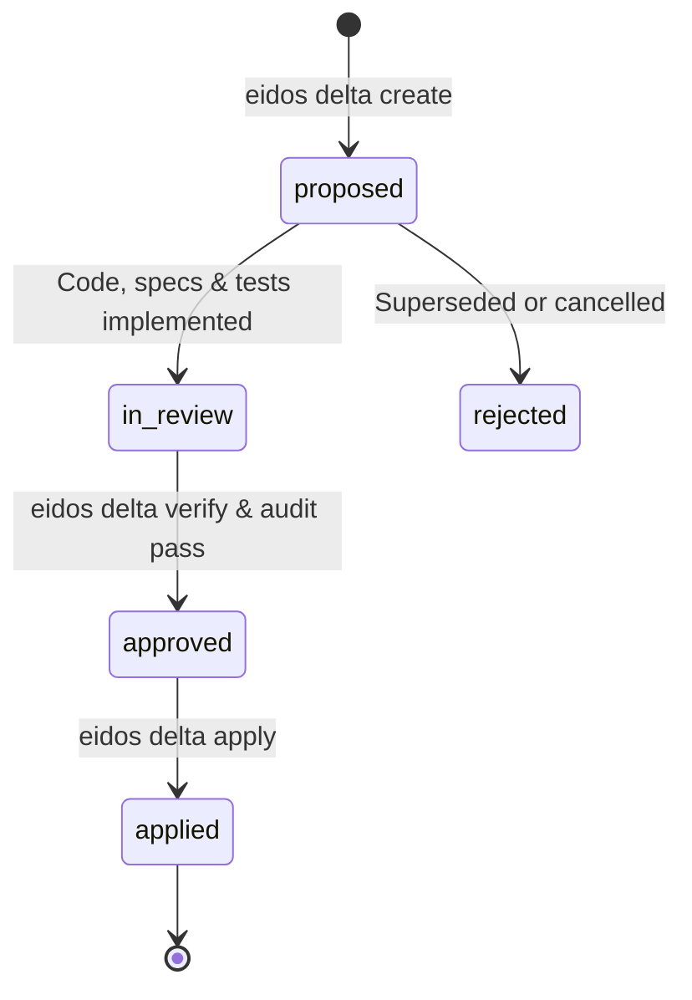

# SpecDeltas (DLT-*)

When architecture needs to change, how do you track the change without creating dead ADRs? Eidos uses **SpecDeltas**.

A **SpecDelta** is a semantic mutation artifact describing an architectural change, why it was made, which living specifications were updated, and which tests verify it.

---

## Dual Workflows: Direct Mode vs. Planned Mode

Eidos recognizes that software development cannot be burdened by ceremony for every localized fix. It enforces **Dual Workflows (`POL-003`)**:

| Mode | When to Use | How It Works |
| :--- | :--- | :--- |
| **Direct Mode** *(Default for localized changes)* | Bug fixes, single-container refactors, adding an internal helper or non-breaking CLI flag, test/doc updates | Co-evolve code in `src/`, tests in `tests/`, and living specs in `eidos/` directly in the same commit. `eidos drift` verifies that touched components or their 1-hop knowledge graph neighborhood have substantive spec updates. |
| **Planned Mode** *(SpecDelta Lifecycle)* | New C4 containers (`CNT-*`), breaking contract (`CTR-*`) changes, cross-domain features, new policies (`POL-*`), deprecations/removals | Author a formal SpecDelta (`DLT-*`) declaring `intent` and `mutations` (with `expect.body` / `expect.frontmatter` post-conditions; scope and downstream blast radius are derived automatically from the knowledge graph). Implement code and spec changes, verify with `eidos delta verify`, audit removals with `eidos delta audit`, and reconcile via `eidos delta apply`. |

---

## The SpecDelta Mutation Lifecycle (Planned Mode)



All SpecDeltas reside in **flat storage** under `eidos/deltas/dlt-yyyy-nnn.adoc` so file paths never break across Git commits when statuses change, and can be filtered by lifecycle state (`proposed`, `in_review`, `approved`, `applied`, `rejected`) via `eidos delta list --status <state>` or `eidos delta status`.

---

## Anatomy of a SpecDelta (`delta.schema.yaml`)

A SpecDelta document (`eidos/deltas/dlt-2026-051.adoc`) combines strongly-typed YAML frontmatter with human-readable architectural rationale:

```asciidoc
---
type: delta/mutation
id: DLT-2026-051
title: "Close Spec-to-Code Drift Detection Bypasses for Unowned Code and 1-Hop Neighborhoods"
status: applied # proposed | in_review | approved | applied | rejected

intent:
  kind: bug # feature | enabler | bug
  bug_classification: spec_violation # spec_violation | spec_gap (for kind: bug)
  severity: high # low | medium | high | critical
  motivation: "Eliminate spec-to-code drift bypasses where unowned source files pass or trivial whitespace spec edits satisfy coverage."

mutations:
  - operation: modify
    target: "CNT-EIDOS-VCS"
    details: "Harden CMP-DRIFT-DETECTOR in src/eidos/vcs/drift.py to flag unowned structural code files and enforce substantive spec diffs."
    expect:
      body:
        contains:
          - "CMP-DRIFT-DETECTOR"
  - operation: add
    target: "INV-VCS-UNOWNED-CODE-DRIFT"
    parent: "CAP-VCS-001"
    details: "Require unowned structural code files to trigger drift unless claimed by a container/component."

tombstone:
  search_tokens:
    - "legacy_drift_fallback"
  allowed_reasons:
    - path: "tests/test_drift.py"
      reason: "Negative regression test verifying legacy fallback is rejected."

vcs:
  base_commit: "a1b2c3d"
  branch: "fix/drift-unowned-code"
---
= SpecDelta: Close Spec-to-Code Drift Detection Bypasses

== Rationale & Context
Previously, modifying an unowned source file could pass drift checks if an unrelated specification was edited in the same commit.

== Verification Checklist
* [x] `eidos delta verify DLT-2026-051` passes.
* [x] `eidos validate eidos && eidos drift --uncommitted` exits `0`.
```

---

## How the SpecDelta Engine Works Under the Hood

1. **Composable `operation` + `target` Mutations & Graph-Derived Scope (`DLT-2026-085`, `DLT-2026-087`, `DLT-2026-090`)**:
   Every mutation targets a specific entity in the living architecture via `operation: add | modify | remove | deprecate`, `x-eidos-ref` validated `target` (inferring the entity type from its canonical prefix: `DOM-*`, `CAP-*`, `PER-*`, `POL-*`, `INV-*`, `ARCH-*`, `CNT-*`, `CMP-*`, `CTR-*`, `DS-*`, `UIC-*`, `SCR-*`, `CLT-*`, `FLOW-*`), and optional `parent` scope for `add` / `remove` of child entities (`INV-*`, inline `CMP-*`; omitted on `modify`), while `affects` and `blast_radius` are derived automatically from the SQLite knowledge graph:
   * **Product & Governance**: `DOM-*`, `CAP-*`, `PER-*`, `POL-*`, `INV-*`.
   * **Technical Architecture**: `ARCH-*`, `CNT-*`, `CMP-*`, `CTR-*`.
   * **Design & Experience**: `DS-*`, `UIC-*`, `SCR-*`, `CLT-*`, `FLOW-*`.
2. **Closed-Schema Declarative Post-Conditions (`expect:`) & Verification (`eidos delta verify`, `DLT-2026-079`)**:
   Each mutation item can include a strictly schema-validated (`additionalProperties: false`) `expect:` block containing `frontmatter:` assertions (`responsibility`, `source_path`, `rule`, `test_binding`, `status`, `version`, `category`, `custom`, with list-subset matching) and/or `body:` assertions (`contains` / `not_contains`, evaluated after stripping YAML and AsciiDoc comments). `eidos delta verify <ID>` deterministically verifies that `add`/`modify` targets exist and were substantively updated relative to `vcs.base_commit` / `delta_baselines`, `remove` targets are deleted, and all `expect:` assertions pass—reporting specific `failure_reason` diagnostics on any mismatch.
3. **Cross-Ref Collision-Safe IDs & Verified In-Place Application (`eidos delta create`, `eidos delta apply [--verify/--no-verify]`, `DLT-2026-080`, `DLT-2026-083`, `DLT-2026-088`)**:
   `eidos delta create` scans all local and remote Git refs (`refs/heads/*`, `refs/remotes/*`) to generate collision-free `DLT-YYYY-NNN` IDs (with optional `--slug` suffixes) and snapshots baseline files into managed `delta_baselines` SQLite storage. `eidos delta apply` verifies all declared mutations against the living specification catalog by default (`--verify`, or bypass via `--no-verify`), validates the updated SpecDelta via `SpecValidator`, and transitions `status: applied` in place.
4. **Reverse-Dependency Tombstone Auditing (`eidos delta audit`)**:
   When a SpecDelta removes or deprecates an entity, `DeltaAuditor` enumerates Git-tracked files across specs, code, tests, and docs for lingering references, separating **approved references** (historical deltas/explorations, negative tests, or `tombstone.allowed_reasons`) from **unacknowledged active leaks**.
5. **Automated Changelog Compilation (`eidos delta changelog`)**:
   `ChangelogGenerator` combines Git release tags (`v*.*.*`) with applied SpecDeltas (classified via `intent.kind` and `mutations[].operation`) to generate a Keep a Changelog compliant `CHANGELOG.md` and `docs/changelog.md`.

---

## CLI Commands for SpecDeltas

```bash
# 1. Scaffold a new SpecDelta (ID defaults to collision-free 'auto'; optional --slug appends title slug)
eidos delta create \
  --title "Add Rate Limiting Contract" \
  --kind feature \
  --slug

# Or specify an explicit SpecDelta ID:
eidos delta create DLT-2026-055 \
  --title "Add Rate Limiting Contract" \
  --kind feature

# 2. List all SpecDeltas or view/transition the lifecycle status
eidos delta list
eidos delta status
eidos delta status DLT-2026-055 in_review

# 3. Verify all declared mutations and expect: post-conditions
eidos delta verify DLT-2026-055 --json

# 4. Audit removed/deprecated entities for dangling references
eidos delta audit DLT-2026-055 --strict

# 5. Reconcile and apply the SpecDelta in-place (verifies mutations by default; optional --no-verify)
eidos delta apply DLT-2026-055

# 6. Compile CHANGELOG.md and docs/changelog.md from applied SpecDeltas
eidos delta changelog
```

