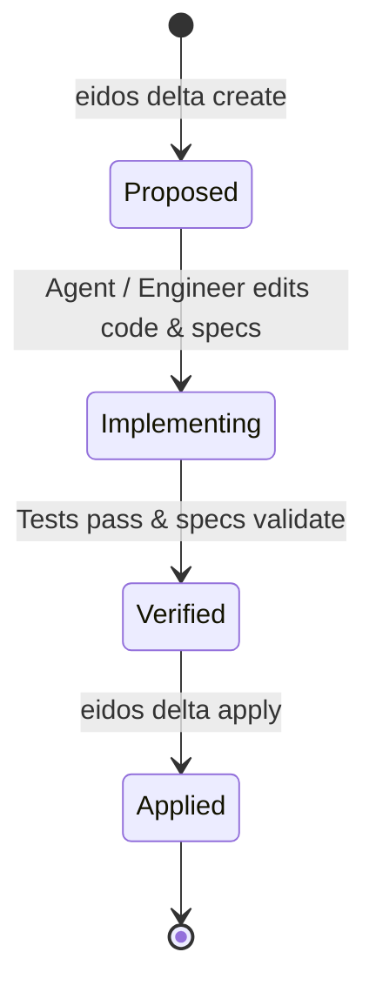

# SpecDeltas (DLT-*)

When architecture needs to change, how do you track the change without creating dead ADRs? Eidos uses **SpecDeltas**.

A **SpecDelta** is a semantic mutation artifact describing an architectural change, why it was made, which living specifications were updated, and which tests verify it.

---

## Dual Workflows: Direct Mode vs. Planned Mode

Eidos recognizes that software development cannot be burdened by unnecessary paperwork for every small fix. It introduces **Dual Workflows**:

| Mode | When to Use | How It Works |
| :--- | :--- | :--- |
| **Direct Mode** *(Default)* | Fast, routine tasks, bug fixes, small features, refactoring | Co-evolve code in `src/` and living specs in `eidos/` directly in the same commit. Git diffs serve as the change delta. `eidos drift` verifies synchronization automatically. |
| **Planned Mode** *(Optional)* | Complex, breaking, multi-component, or high-risk changes | Author a formal SpecDelta (`DLT-*`) before writing code, review blast radius and contracts with the team, implement against the checklist, and reconcile. |

---

## The SpecDelta Mutation Lifecycle (Planned Mode)



1. **Proposed**: A new delta is created (`eidos delta create`) to document the planned architectural mutation and its motivation.
2. **Implementing**: Code is authored alongside in-place updates to the living specs (`eidos/architecture/`, `eidos/policies/`, etc.).
3. **Verified**: The test suite confirms all invariants pass, and `eidos drift` confirms specification integrity.
4. **Applied**: The delta is reconciled in-place to `status: applied` (`eidos delta apply`), recording the historical audit trail without fragmenting the system context.

---

## Anatomy of a SpecDelta

A SpecDelta file (`eidos/deltas/dlt-2026-004.adoc`):

```asciidoc
---
id: DLT-2026-004
type: delta/mutation
status: applied
author: Agent
created: 2026-10-11
applied: 2026-10-11
affects:
  components:
    - CMP-EIDOS-CORE
  contracts:
    - CTR-EIDOS-CLI
  policies:
    - POL-001-GIT-SOURCE-OF-TRUTH
---
= SpecDelta: Add Strict Schema Cross-Reference Checking

== Rationale
Previously, broken cross-references between component contracts and provider IDs
could go undetected until runtime portal rendering.

== Applied Changes
* Updated `eidos.core.validator.SpecValidator` to enforce bidirectional link checks.
* Updated `CTR-EIDOS-CLI` contract specification.
* Added invariant test `tests/test_validator.py::test_cross_reference_integrity`.
```

---

## CLI Commands for SpecDeltas

### Create a Delta

```bash
eidos delta create "Refactor Authentication Middleware"
```

### Apply and Reconcile a Delta

```bash
eidos delta apply dlt-2026-004
```

### List Deltas by Status

```bash
eidos delta list
```

